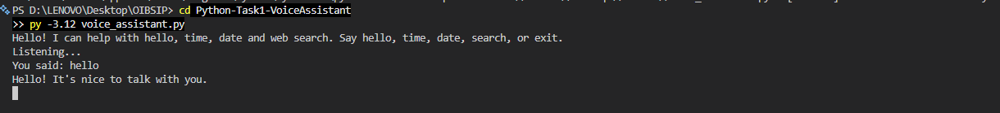
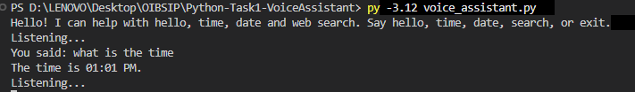
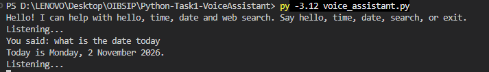
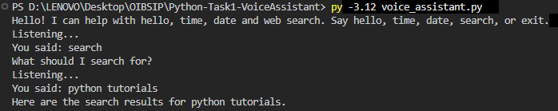
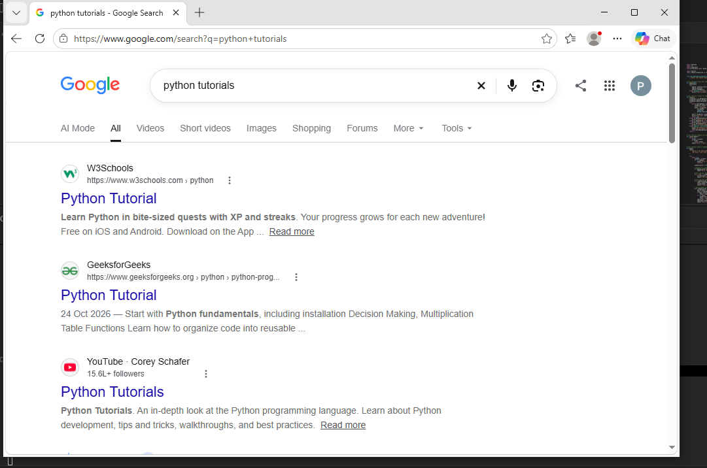
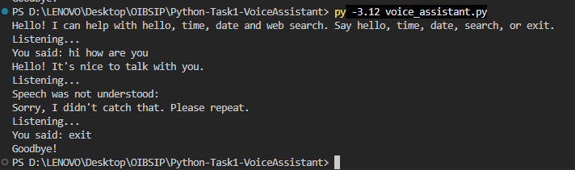

# Python Voice Assistant

A beginner-friendly, voice-controlled Python assistant for quick answers and Google searches.

[](https://www.python.org/)
[](https://pypi.org/project/SpeechRecognition/)
[](https://pypi.org/project/pyttsx3/)
[](LICENSE)

## About

This is **Task 1 (Voice Assistant, Beginner Tier)** of my Python Programming internship at **Oasis Infobyte (OIBSIP)**.
The project listens to spoken commands, responds with speech, and can open Google search results in your browser.

## Features

- [x] 🎙️ Captures voice input from a microphone
- [x] 👋 Greets you when you say hello, hi, or hey
- [x] 🕒 Tells you the current time
- [x] 📅 Tells you today's date or day
- [x] 🔎 Searches Google for a spoken topic and opens the results in your browser
- [x] 🔁 Asks you to repeat when it cannot understand your voice
- [x] 🗣️ Reads assistant responses aloud with text-to-speech
- [x] 🎤 Gives a clear message if a microphone is unavailable
- [x] 👋 Says goodbye when you ask it to stop or press Ctrl+C

## Commands

The assistant checks for command words in what it hears, so you can phrase requests naturally.

| You say | Assistant does |
|---|---|
| "Hello", "hi", or "hey" | Replies: "Hello! It's nice to talk with you." |
| "Time" or a sentence containing "time" | Tells you the current time |
| "Date" or "day" | Tells you today's weekday and date |
| "Search cats" / "Search for cats" / "Google cats" | Opens Google results for the topic and confirms the search |
| "Search" or "Google" without a topic | Asks what to search for, listens for your topic, then opens Google results |
| "Exit", "bye", "stop", or "quit" | Says goodbye and ends the assistant |
| Any other command | Explains that it can help with hello, time, date, and web search |

## Sample session

Example output (the time and recognized speech will vary):

```text
Hello! I can help with hello, time, date and web search. Say hello, time, date, search, or exit.
Listening...
You said: hello
Hello! It's nice to talk with you.
Listening...
You said: what time is it
The time is 10:30 AM.
Listening...
You said: search for python tutorials
Here are the search results for python tutorials.
Listening...
You said: exit
Goodbye!
```

## Screenshots

**Hello greeting**



**Time**



**Date**



**Search terminal output**



**Search results in browser**



**Error handling and exit**



## How it works

1. **Listen:** `listen()` captures microphone audio and prints "Listening..." while waiting for speech.
2. **Recognize:** `listen()` sends the audio to Google speech recognition in English (India), then returns recognized words in lowercase.
3. **Match a command:** `main()` checks the recognized words for greetings, time, date, search, and exit commands.
4. **Respond:** `speak()` prints each reply and reads it aloud. For a search, `main()` opens Google results in the browser. If a search has no topic, `listen_again()` listens again for one.

## Tech stack

| Library / module | Purpose |
|---|---|
| Python 3.12 | Runs the voice assistant |
| SpeechRecognition | Captures audio and recognizes speech using Google's online service |
| PyAudio | Provides microphone audio input for SpeechRecognition |
| pyttsx3 | Speaks the assistant's replies aloud |
| `datetime` (standard library) | Gets the current time and date |
| `re` and `urllib.parse` (standard library) | Extracts and URL-encodes search topics |
| `webbrowser` (standard library) | Opens Google search results |

## Project structure

```text
Python-Task1-VoiceAssistant/
├── voice_assistant.py   # Voice assistant logic
├── requirements.txt     # Python package dependencies
├── README.md            # Project guide
├── LICENSE              # MIT License
└── screenshots/         # Output screenshots of the assistant
    ├── output1.png
    ├── output2.png
    ├── output3.png
    ├── output4.1.png
    ├── output4.2.png
    └── output5.png
```

## Installation and usage

1. Install **Python 3.12** and make sure the `py` launcher is available.
2. Open PowerShell or Command Prompt in the project folder.
3. Install the dependencies:

   ```powershell
   py -3.12 -m pip install -r requirements.txt
   ```

4. Connect or enable a microphone, then start the assistant:

   ```powershell
   py -3.12 voice_assistant.py
   ```

5. Wait for **"Listening..."** before speaking. Say a command such as "hello", "time", "date", or "search for Python tutorials".
6. Say "exit" (or "bye", "stop", or "quit") to close the assistant. You can also press **Ctrl+C**.

## Troubleshooting

- **PyAudio installation fails on Windows:** Try installing `pipwin`, then use it to install PyAudio:

  ```powershell
  py -3.12 -m pip install pipwin
  pipwin install pyaudio
  ```

- **Microphone not detected or blocked:** Check that the microphone is connected and selected as the input device. In Windows, open **Settings → Privacy & security → Microphone** and enable microphone access for apps and desktop apps.
- **"Sorry, I didn't catch that":** Move to a quiet room, wait until you hear "Listening...", and speak clearly. The assistant asks you to repeat if no speech is recognized.
- **No internet connection:** Speech recognition uses Google's online service, and web searches require internet access. Check your connection and try again.

## Future improvements

Ideas for a future, more advanced version include:

- Add natural language processing with `nltk`
- Get weather information from a weather API
- Send emails with `smtplib`
- Add smart home features

## Author

**Payal Shekhawat** — BCA student  
Built during the Oasis Infobyte Python internship.
