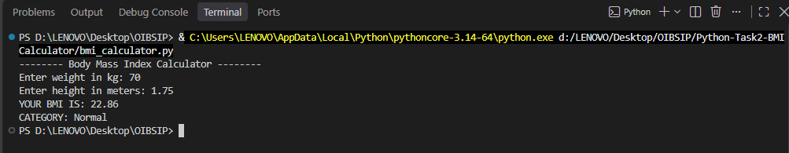
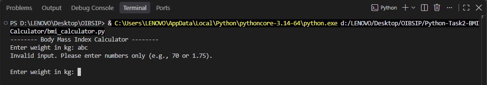
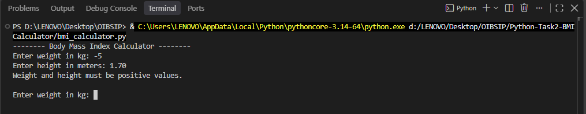
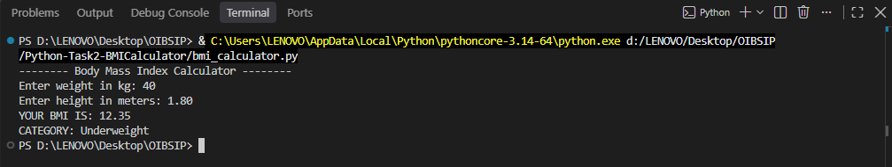

# BMI Calculator

A command-line Python program that calculates a user's Body Mass Index (BMI) and classifies it into a health category.

Built as Task 2 (Beginner Tier) of the Python Programming Internship at Oasis Infobyte (OIBSIP).

# Features

- Takes weight (in kg) and height (in meters) as input from the user
- Calculates BMI using the formula: `BMI = weight / (height²)`
- Classifies the result into a standard health category
- Displays the BMI value rounded to 2 decimal places along with the category
- Input validation:
  - Rejects non-numeric input with a helpful error message
  - Rejects zero and negative values
  - Asks the user to try again instead of crashing

# BMI Categories

| BMI Range   | Category    |
|-------------|-------------|
| Below 18.5  | Underweight |
| 18.5 – 24.9 | Normal      |
| 25 – 29.9   | Overweight  |
| 30 and above| Obese       |

# Tech Stack

- Python 3
- `input()` and basic arithmetic

# How to Run

1. Make sure Python 3 is installed on your system.
2. Download or clone this repository.
3. Open a terminal in the `Python-Task2-BMICalculator` folder.
4. Run the program:

```bash
python bmi_calculator.py
```

# Sample Output

**Valid input (Normal category)**



**Invalid input (non-numeric)**



**Invalid input (negative value)**



**Underweight category**



# Project Structure

```
Python-Task2-BMICalculator/
├── bmi_calculator.py
├── README.md
└── screenshots/
```

# Author

Payal Shekhawat
Python Programming Intern, Oasis Infobyte
#oasisinfobyte