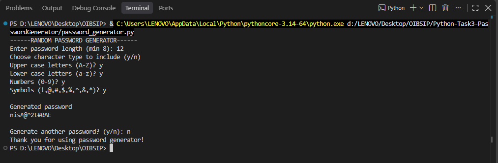
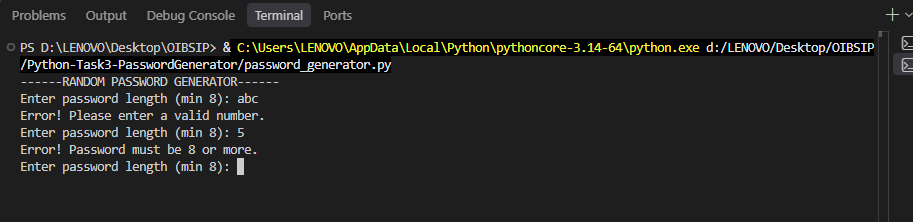
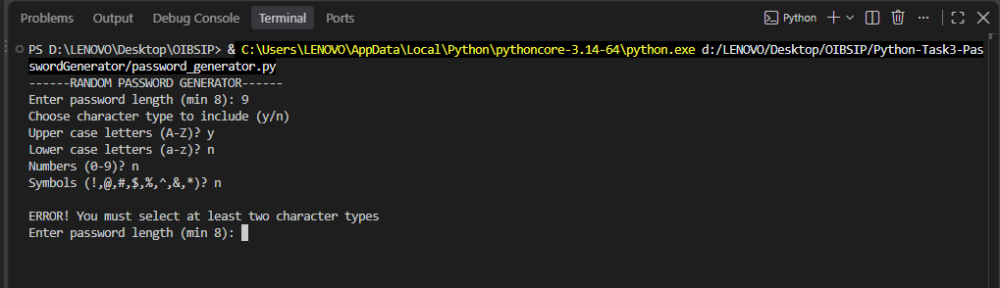
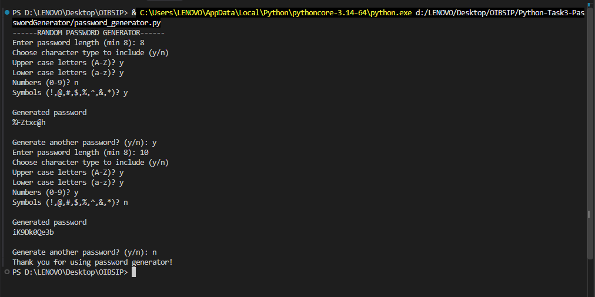

# Random Password Generator

A command-line Python program that generates strong, random passwords based on the length and character types chosen by the user.

Built as Task 3 (Beginner Tier) of the Python Programming Internship at Oasis Infobyte (OIBSIP).

# Features

- Asks the user for the password length (minimum 8 characters enforced)
- Lets the user choose which character types to include:
  - Uppercase letters (A-Z)
  - Lowercase letters (a-z)
  - Numbers (0-9)
  - Symbols (!@#$%^&*)
- Requires at least 2 character types to be selected
- Generates a password that contains at least one character from every selected type
- Input validation:
  - Rejects non-numeric length
  - Rejects length below 8
  - Rejects selections with fewer than 2 character types
- Option to generate another password without restarting the program

# Tech Stack

- Python 3
- `random` module
- `string` module

# How to Run

1. Make sure Python 3 is installed on your system.
2. Download or clone this repository.
3. Open a terminal in the `Python-Task3-PasswordGenerator` folder.
4. Run the program:

```bash
python password_generator.py
```

# How It Works

1. The program asks for the password length and checks that it is 8 or more.
2. The user answers y/n for each character type.
3. The program adds one random character from each selected type, so the password always matches the chosen criteria.
4. The remaining characters are picked randomly from all selected types.
5. The characters are shuffled and the final password is displayed.
6. The user can choose to generate another password or exit.

# Sample Output

**Valid input (all character types)**



**Invalid length (non-numeric and below 8)**



**Fewer than 2 character types selected**



**Generating another password**



# Project Structure

```
Python-Task3-PasswordGenerator/
├── password_generator.py
├── README.md
└── screenshots/
```

# Author

**Payal Shekhawat**
Python Programming Intern, Oasis Infobyte
#oasisinfobyte